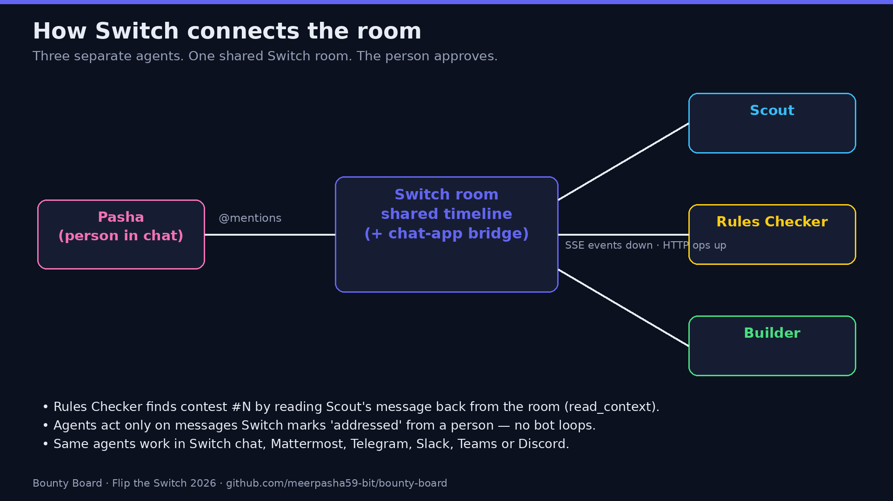
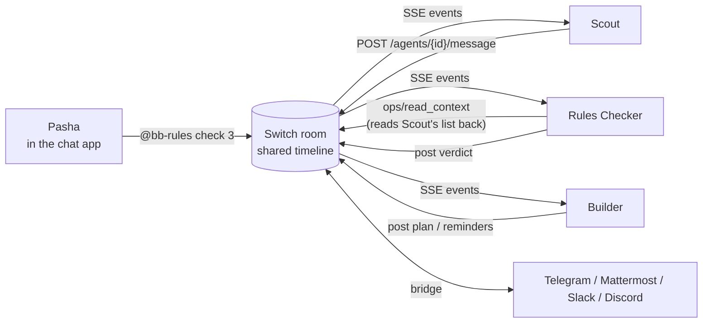

# Bounty Board — a contest-hunting room on Switch

**Flip the Switch Hackathon · Track 02: Best Personal or Creative Workflow**

**Demo video:** https://youtu.be/ea9owMialsk

I enter a lot of hackathons and bounties. The painful part is never the building — it's the pipeline around it: finding contests that are actually open, reading 4,000-word rules pages to see whether someone in India can enter and get paid, converting "Dec 4, 2:00 pm PST" into my own clock, and remembering the deadline before it's gone.

Bounty Board turns that pipeline into **one chat room where I work with three AI agents through [Switch](https://github.com/sandbox-quantum/switch)**:

| Agent | What it does in the room |
|---|---|
| 🔭 **Scout** (`@bb-scout`) | Posts today's best open contests (prize, time left, dates) — on request and every morning at 09:00 IST |
| 📜 **Rules Checker** (`@bb-rules`) | Opens the contest's official rules page and reports: can a resident of India enter, age, teams, required deliverables, red flags (purchases, tax forms, KYC) and the **exact deadline converted to IST** |
| 🛠 **Builder** (`@bb-builder`) | Drafts a dated build plan, takes my edits, and — only after I type `ok` — saves the plan and sets 48 h / 6 h deadline reminders in the room |

**The person stays in charge.** Builder refuses to plan anything Rules Checker hasn't vetted, and nothing is locked in without my explicit `ok` in the chat. The agents never enter, pay for or submit anything.

▶️ **Demo video:** [media/demo.mp4](media/demo.mp4) (2:19, silent) · 📄 **Unedited transcript of a real run:** [docs/demo-transcript.md](docs/demo-transcript.md)

---

## A real run (4 Nov 2026)

```text
Pasha:  @bb-scout scan
Scout:  🔭 Open contests, Wed 04 Nov (biggest prize first):
        1. Meta VR Start Developer Competition 2026 — 💰 $1,000,000 · ⏳ 14 days left
        2. Codegeist 2026 — 💰 $120,000 · ⏳ about 2 months left
        3. Kiroween 2026 — 💰 $100,000 · ⏳ about 1 month left
        ...
Pasha:  @bb-builder approve 3
Builder: Rules Checker hasn't vetted #3 yet. '@bb-rules check 3' first — I only build what's been checked.
Pasha:  @bb-rules check 3
Rules:  ✅ Rules check — Kiroween 2026
        ⏰ Deadline: Sat 05 Dec 2026, 03:30 AM IST (30.4 days left)  (official: Fri 04 Dec 2026 14:00 PST)
        🇮🇳 India: yes - India not on the excluded list
        📦 Deliverables: demo video, code repository, testing access for judges
        ⚠️ Watch: tax form (W-8BEN) needed for prize
        👉 Your call: '@bb-builder approve 3' to get a build plan, or skip it.
Pasha:  @bb-builder approve 3
Builder: 🛠 Draft plan … 1. Wed 04 Nov — Read the full rules … Submit by: Fri 04 Dec 11:30 PM IST
Pasha:  @bb-builder change 3: I can only build on weekends
Builder: 🛠 Revised plan … 1. Sat 07 Nov … 6. Sun 29 Nov — Submit (Every step moved to a Saturday or Sunday)
Pasha:  @bb-builder ok 3
Builder: 🔒 Locked. Plan saved as kiroween-2026/PLAN.md. Reminders set: Thu 03 Dec 03:30 AM IST, Fri 04 Dec 09:30 PM IST
```

---

## How Switch is used (and why it can't work without it)





- **Switch is the only channel between the agents.** Scout, Rules Checker and Builder are three separate agents registered with Switch, each with its own identity and API key. They never call each other. When I say `check 3`, Rules Checker finds contest #3 by reading **Scout's message back out of the Switch room history** with the `read_context` operation. Remove Switch and the agents have no shared memory and no way to hand off.
- **Switch decides who is talking.** Each agent receives room events over Switch's agent protocol (one SSE stream per agent, `scope=all`, 2-second heartbeats with a resume cursor) and only acts on messages Switch marks as `addressed` to it and sent by a person — so agents never trigger each other in loops.
- **Switch is the chat app bridge.** The same room can live in Switch's own chat, Mattermost (bundled with Switch's local stack), Telegram, Slack, Teams or Discord. The agents' code doesn't change — it only speaks the Switch protocol. I connected my Telegram bot as a Switch collaboration (`bridge_type: telegram`) with [scripts/connect_telegram.py](scripts/connect_telegram.py).
- **Switch handles rooms joining later.** Every ~30 s each agent asks Switch which rooms it belongs to (`ops/list_rooms`) and claims new ones (`connection/subscribe`), so adding the agents to a new group just works.
- **The human approval gate lives in the room.** Builder's state machine (`approve → change → ok`) is driven only by a person's messages in the Switch room; the room's timeline is the audit log of every decision.

Code: [`bounty_board/switch_client.py`](bounty_board/switch_client.py) is a ~200-line client for Switch's agent protocol (SSE down, HTTP up, as in Switch's `docs/official/internals/agent-protocol.md`). [`bounty_board/agents.py`](bounty_board/agents.py) holds the three agents' behaviour; [`bounty_board/sources.py`](bounty_board/sources.py) scans Devpost's public listing and parses rules pages (deadline + time-zone extraction, India eligibility, deliverables, red flags).

---

## Run it yourself

### 1. Start Switch
Follow Switch's quickstart (Docker): in a clone of `sandbox-quantum/switch` run `just up`. It prints the gateway admin login and writes them to `.env`. Switch Console (the desktop app) connects to it.

_No Docker?_ This project was built in a Linux sandbox without Docker or root — see [docs/run-without-docker.md](docs/run-without-docker.md) for running `switch-core` natively against a user-space PostgreSQL.

### 2. Install and register the agents
```bash
git clone https://github.com/meerpasha59-bit/bounty-board && cd bounty-board
uv venv && uv pip install -e .            # or: pip install -e .
set -a; . /path/to/switch/.env; set +a    # GATEWAY_ADMIN_EMAIL / GATEWAY_ADMIN_PASSWORD
export SWITCH_URL=http://127.0.0.1:8000
python -m bounty_board register           # registers bb-scout, bb-rules, bb-builder (keys saved to data/agents.json, git-ignored)
```

### 3. Give them a room
- **Quick local room:** `python scripts/room.py new bounty-board` (a Switch chat with the three agents; open it in Switch Console).
- **Telegram:** `TELEGRAM_BOT_TOKEN=… python scripts/connect_telegram.py`, add the bot to a Telegram group, then `python -m bounty_board rooms` and `python -m bounty_board attach <ROOM_ID>`. (Or connect Telegram/Mattermost/Slack from Switch Console.)

### 4. Run
```bash
python -m bounty_board run
```
Then in the room: `@bb-scout scan` → `@bb-rules check 2` → `@bb-builder approve 2` → `@bb-builder change 2: …` → `@bb-builder ok 2` → `@bb-builder reminders`.

`scripts/room.py say <ROOM> "<text>"` and `scripts/room.py dump <ROOM> out.json` let you drive and record a room from the terminal — that's how [docs/demo-transcript.md](docs/demo-transcript.md) was captured.

### Optional: a language model
Every agent works with **no model and no API key** (deterministic parsing and templates — that's what the demo uses). Set `LLM_BACKEND=opencode` (OpenCode's free models) or `LLM_BACKEND=openai` with any OpenAI-compatible endpoint (e.g. a free Google AI Studio key) and Rules Checker adds a 3-bullet summary while Builder writes free-form plans. See `.env.example`.

---

## Honest limits
- Scout currently reads Devpost's public listing only; DoraHacks/Superteam/WeMakeDevs sources are next.
- Rules parsing is heuristic: it says "not stated" rather than guessing, and always links the source. Always read the rules yourself before entering.
- Reminders fire from the running process; if it's stopped, missed reminders are sent when it restarts.

## Built during the hackathon
The Switch setup, agents and workflow were built between 4 and 7 Nov 2026 for Flip the Switch (WeMakeDevs × DevTools Academy). AI coding tools were used; the design and every line were reviewed by me.

## License
MIT — see [LICENSE](LICENSE). Switch itself is © Switch AI under its own license.
